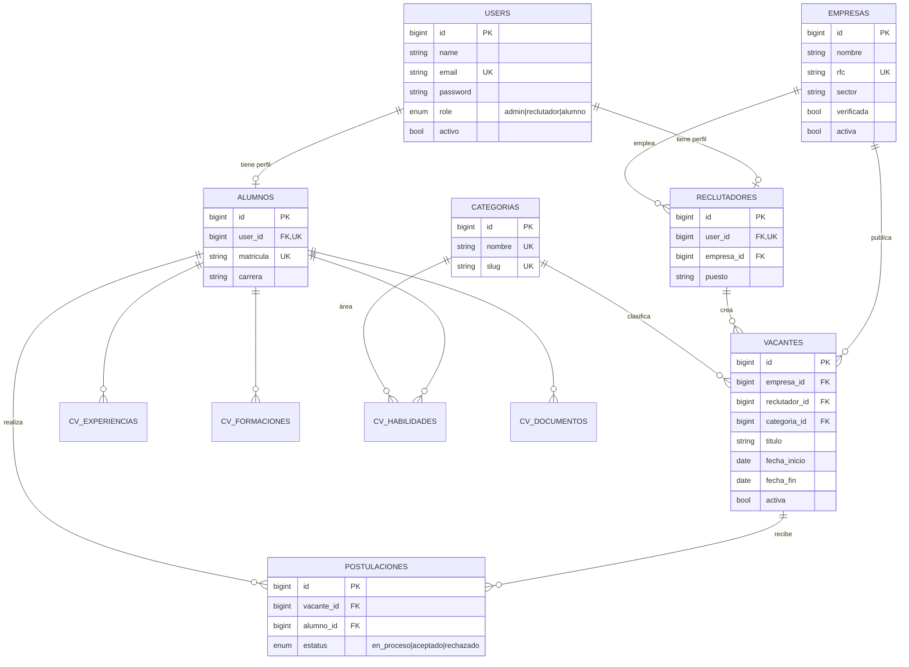

# Vinculación en Línea — UPSLP
## Etapa 1: Arquitectura, modelo de datos y estructura del proyecto

> Proyecto Final · Programación Web II (LC34 / T15A) · ITI · Otoño 2026
> Universidad Politécnica de San Luis Potosí · Dra. Roxana G. Herrera

---

## 1. Entorno y stack

| Capa | Tecnología | Versión en este equipo |
|---|---|---|
| Lenguaje | PHP | 8.4.15 |
| Framework | Laravel | 13.43 |
| Panel admin | Filament | 5.x |
| Base de datos | MySQL / MariaDB (WAMP) | MySQL 8.4.7 · MariaDB 11.4.9 |
| Frontend | Blade + Tailwind CSS 4 + Alpine.js | — |
| Tooling | Node.js + Vite 8 | Node 24.21 · npm 11.19 |
| PDF | `barryvdh/laravel-dompdf` | se instala en la Etapa 3 |
| Gráficas (sitio público) | Chart.js (npm) | se instala en la Etapa 4 |

Ya están disponibles las extensiones de PHP que se necesitan: `pdo_mysql`, `mbstring`, `dom`, `gd` (para imágenes en los PDF), `intl`, `fileinfo` y `zip`.

---

## 2. Decisiones de arquitectura

### 2.1 Tres áreas, una sola aplicación

```
                    ┌──────────────────────────────────────────┐
                    │           Laravel 13 (una app)            │
                    ├──────────────┬───────────────┬────────────┤
   Público ───────▶ │ Sitio Blade  │ Portal Alumno │  Portal    │
   (sin sesión)     │ Inicio, FAQ, │  /alumno/*    │ Reclutador │
                    │ Contacto...  │               │ /reclutador│
                    ├──────────────┴───────────────┴────────────┤
   Admin ─────────▶ │        Panel Filament  /admin             │
                    ├───────────────────────────────────────────┤
                    │ Modelos Eloquent · Policies · Enums ·      │
                    │ Services (Postulación, Reportes PDF)       │
                    ├───────────────────────────────────────────┤
                    │           MySQL / MariaDB                  │
                    └───────────────────────────────────────────┘
```

- **Administrador → Filament** (`/admin`). Filament ya resuelve tablas con filtros, formularios, widgets de métricas y acciones de exportación, así que es la herramienta adecuada para la administración institucional.
- **Reclutador y Alumno → Blade + Tailwind**, como pide la Etapa 4. Así se demuestra el trabajo de frontend (Blade, Tailwind, JS y Vite) que evalúa la materia, en lugar de esconderlo dentro de Filament.
- La **lógica de negocio va en el backend**: los controladores son delgados y delegan en Form Requests (validación), Policies (autorización) y servicios (`PostulacionService`, `ReporteService`). Los paneles de Filament y los portales Blade usan las mismas reglas.

### 2.2 Usuarios y roles

- Una sola tabla `users` con una columna `role` (`admin`, `reclutador`, `alumno`), respaldada por un **Enum de PHP** `App\Enums\Rol`.
- Los datos propios de cada rol viven en tablas de **perfil 1:1** (`alumnos`, `reclutadores`). Así `users` queda limpia y cada perfil tiene sus propias relaciones (el alumno tiene CV y postulaciones; el reclutador pertenece a una empresa).
- **Autorización en tres niveles:**
  1. Middleware `role:alumno` / `role:reclutador` en los grupos de rutas.
  2. Policies (`VacantePolicy`, `PostulacionPolicy`, `EmpresaPolicy`, `CvDocumentoPolicy`): por ejemplo, un reclutador solo edita las vacantes **de su empresa**.
  3. `User::canAccessPanel()` (contrato `FilamentUser`): solo `admin` entra a `/admin`.
- **Autenticación:** controladores propios y ligeros (login, registro de alumno, registro de reclutador, logout) con sesiones de Laravel, `RateLimiter` en el login, regeneración de sesión e invalidación al cerrar sesión. No se usa un starter kit para que el código quede pequeño y fácil de explicar en la entrega.
- Las cuentas tienen el campo `activo`; el administrador puede desactivar una cuenta sin borrarla.

### 2.3 Vigencia de las vacantes

Una vacante está **vigente** cuando se cumplen las tres condiciones:

```
activa = true  AND  fecha_inicio <= HOY  AND  fecha_fin >= HOY
```

Esto se implementa como el scope `Vacante::vigentes()` y el accessor `$vacante->estado_vigencia` (`programada`, `vigente`, `por_vencer` si faltan 7 días o menos, `vencida`, `inactiva`). Los filtros del buscador usan esos mismos estados. **No se puede postular a una vacante que no esté vigente**, y eso se valida en el backend.

### 2.4 Postulación única (regla clave)

Hay cuatro capas de defensa, de la más visible a la más fuerte:

1. **UI:** si el alumno ya se postuló, el botón aparece como "Ya te postulaste" y está deshabilitado.
2. **Form Request** `StorePostulacionRequest`: el alumno debe tener rol `alumno`, la vacante debe estar vigente y no puede existir una postulación previa.
3. **Service** `PostulacionService::postular()`: hace la inserción dentro de una transacción y captura `UniqueConstraintViolationException` por si llegan dos peticiones simultáneas (doble clic).
4. **Base de datos:** índice `UNIQUE (vacante_id, alumno_id)` en `postulaciones`. Aunque fallaran las capas anteriores, MySQL rechaza el duplicado.

### 2.5 Seguridad

| Amenaza | Mitigación |
|---|---|
| CSRF | `@csrf` en todos los formularios; middleware `PreventRequestForgery` |
| XSS | Salida con `{{ }}` (escapado); nunca `{!! !!}` con datos del usuario; descripciones en texto plano con `nl2br(e())` |
| SQLi | Eloquent y Query Builder con *bindings*; las búsquedas `LIKE` también van parametrizadas |
| Asignación masiva | `$fillable` explícito en cada modelo; `role` nunca es asignable desde formularios públicos |
| Subida de archivos | Validación de `mimes:pdf,jpg,png` y de tamaño máximo; disco `local` privado; descarga solo a través de un controlador con Policy |
| Fuerza bruta | `RateLimiter` en login y en el formulario de contacto |
| Contraseñas | Hash bcrypt y regla `Password::defaults()` (mínimo 8, letras y números) |

---

## 3. Modelo entidad-relación



Cardinalidades que pide el enunciado:
- Una **empresa** tiene **muchas vacantes**; cada vacante pertenece a **una sola** empresa.
- Una **empresa** tiene **uno o más reclutadores**; cada reclutador pertenece a una empresa. Este es el "vínculo empresa–reclutador" que administra el administrador.
- Un **alumno** tiene **muchas postulaciones**, pero **solo una por vacante**.

---

## 4. Diccionario de datos

Convenciones: tablas en español y en plural; motor InnoDB con `utf8mb4_unicode_ci`; todas las tablas llevan `created_at` y `updated_at`. **FK** = llave foránea; **UK** = índice único; **IX** = índice simple.

### 4.1 `users` (tabla de Laravel extendida)
| Columna | Tipo | Restricciones |
|---|---|---|
| id | bigint unsigned | PK |
| name | varchar(255) | requerido |
| email | varchar(255) | **UK** |
| email_verified_at | timestamp | nullable |
| password | varchar(255) | hash bcrypt |
| role | enum('admin','reclutador','alumno') | default `alumno`, **IX** |
| activo | boolean | default `true` |
| remember_token | varchar(100) | nullable |

### 4.2 `empresas`
| Columna | Tipo | Restricciones |
|---|---|---|
| id | bigint | PK |
| nombre | varchar(150) | requerido, **IX** |
| razon_social | varchar(200) | nullable |
| rfc | varchar(13) | **UK**, nullable (12–13 caracteres) |
| sector | varchar(100) | nullable |
| descripcion | text | nullable |
| sitio_web | varchar(255) | nullable, URL |
| email_contacto | varchar(150) | nullable |
| telefono | varchar(20) | nullable |
| direccion | varchar(255) | nullable |
| municipio | varchar(100) | default `San Luis Potosí` |
| estado | varchar(100) | default `San Luis Potosí` |
| logo_path | varchar(255) | nullable (disco `public`) |
| verificada | boolean | default `false` (la verifica el admin) |
| activa | boolean | default `true` |
| deleted_at | timestamp | *soft delete* |

### 4.3 `reclutadores` (perfil 1:1 de `users`)
| Columna | Tipo | Restricciones |
|---|---|---|
| id | bigint | PK |
| user_id | FK → users.id | **UK**, `ON DELETE CASCADE` |
| empresa_id | FK → empresas.id | nullable, `ON DELETE SET NULL` |
| puesto | varchar(100) | nullable |
| telefono | varchar(20) | nullable |

> `empresa_id` es nullable: un reclutador que se registra puede capturar su empresa en el mismo paso o quedar pendiente de que el admin lo vincule. Mientras no tenga empresa no puede publicar vacantes; esto lo controla `VacantePolicy::create`.

### 4.4 `alumnos` (perfil 1:1 de `users`)
| Columna | Tipo | Restricciones |
|---|---|---|
| id | bigint | PK |
| user_id | FK → users.id | **UK**, `ON DELETE CASCADE` |
| matricula | varchar(20) | **UK** |
| carrera | varchar(150) | requerido (catálogo de carreras de la UPSLP en un Enum/config) |
| cuatrimestre | tinyint unsigned | nullable, 1–10 |
| telefono | varchar(20) | nullable |
| fecha_nacimiento | date | nullable |
| ciudad | varchar(100) | nullable |
| resumen | text | nullable (perfil profesional del CV) |
| linkedin_url | varchar(255) | nullable |
| portafolio_url | varchar(255) | nullable |
| foto_path | varchar(255) | nullable |

### 4.5 `categorias` (catálogo, 12 registros fijos vía Seeder)
| Columna | Tipo | Restricciones |
|---|---|---|
| id | bigint | PK |
| nombre | varchar(100) | **UK** |
| slug | varchar(120) | **UK** (para URL: `/vacantes?categoria=ingenieria`) |
| descripcion | varchar(255) | nullable |
| icono | varchar(60) | nullable (nombre de Heroicon) |

### 4.6 `vacantes`
| Columna | Tipo | Restricciones |
|---|---|---|
| id | bigint | PK |
| empresa_id | FK → empresas.id | `ON DELETE CASCADE`, **IX** |
| reclutador_id | FK → reclutadores.id | nullable, `ON DELETE SET NULL` |
| categoria_id | FK → categorias.id | `ON DELETE RESTRICT`, **IX** |
| titulo | varchar(150) | requerido |
| slug | varchar(180) | **UK** |
| descripcion | text | requerido |
| requisitos | text | nullable |
| prestaciones | text | nullable |
| modalidad | enum('presencial','remoto','hibrido') | default `presencial` |
| tipo_contrato | enum('tiempo_completo','medio_tiempo','practicas','estadia','servicio_social','proyecto') | requerido |
| salario_min | decimal(10,2) | nullable |
| salario_max | decimal(10,2) | nullable, `>= salario_min` (Form Request) |
| ubicacion | varchar(150) | nullable |
| plazas | smallint unsigned | default 1 |
| fecha_inicio | date | requerido |
| fecha_fin | date | requerido, `>= fecha_inicio` (Form Request) |
| activa | boolean | default `true` |
| deleted_at | timestamp | *soft delete* (la "baja" conserva el historial de postulaciones) |

Índices: `IX (activa, fecha_inicio, fecha_fin)` para el filtro de vigencia y `IX (categoria_id, activa)`. En MySQL se agrega además un `FULLTEXT (titulo, descripcion)` para la búsqueda en sitio; en SQLite (entorno de pruebas) se usa `LIKE` como respaldo.

### 4.7 `postulaciones`
| Columna | Tipo | Restricciones |
|---|---|---|
| id | bigint | PK |
| vacante_id | FK → vacantes.id | `ON DELETE CASCADE` |
| alumno_id | FK → alumnos.id | `ON DELETE CASCADE` |
| estatus | enum('en_proceso','aceptado','rechazado') | default `en_proceso`, **IX** |
| carta_presentacion | text | nullable |
| comentario_reclutador | text | nullable (retroalimentación visible para el alumno) |
| estatus_actualizado_en | timestamp | nullable |
| | | **UK (vacante_id, alumno_id)** ← postulación única |

En pantalla, el Enum `EstatusPostulacion` muestra las etiquetas **EN PROCESO**, **ACEPTADO** y **RECHAZADO**, cada una con su color (ámbar, verde y rojo).

### 4.8 CV estructurado del alumno
**`cv_experiencias`**: empleos anteriores, prácticas y estadías.
| Columna | Tipo | Restricciones |
|---|---|---|
| alumno_id | FK → alumnos.id | `CASCADE`, **IX** |
| empresa | varchar(150) | requerido |
| puesto | varchar(150) | requerido |
| descripcion | text | nullable (logros y actividades) |
| fecha_inicio | date | requerido |
| fecha_fin | date | nullable |
| actual | boolean | default `false` |

**`cv_formaciones`**: formación académica, cursos y certificaciones.
| Columna | Tipo | Restricciones |
|---|---|---|
| alumno_id | FK → alumnos.id | `CASCADE` |
| institucion | varchar(150) | requerido |
| titulo | varchar(150) | requerido |
| nivel | enum('bachillerato','tsu','licenciatura','maestria','diplomado','curso','certificacion') | requerido |
| fecha_inicio | date | nullable |
| fecha_fin | date | nullable |
| en_curso | boolean | default `false` |

**`cv_habilidades`**: habilidades agrupadas por área de conocimiento.
| Columna | Tipo | Restricciones |
|---|---|---|
| alumno_id | FK → alumnos.id | `CASCADE` |
| categoria_id | FK → categorias.id | nullable, `SET NULL` |
| nombre | varchar(100) | requerido |
| nivel | enum('basico','intermedio','avanzado','experto') | default `intermedio` |
| | | **UK (alumno_id, nombre)** |

**`cv_documentos`**: documentos que avalan la experiencia y competitividad del alumno.
| Columna | Tipo | Restricciones |
|---|---|---|
| alumno_id | FK → alumnos.id | `CASCADE` |
| nombre | varchar(150) | requerido |
| tipo | enum('certificado','constancia','carta_recomendacion','titulo','cv_pdf','otro') | requerido |
| archivo_path | varchar(255) | disco privado `local` |
| mime | varchar(100) | |
| tamano_kb | int unsigned | |

### 4.9 `mensajes_contacto`
| Columna | Tipo | Restricciones |
|---|---|---|
| nombre | varchar(120) | requerido |
| email | varchar(150) | requerido |
| asunto | varchar(150) | requerido |
| mensaje | text | requerido |
| ip | varchar(45) | nullable |
| leido | boolean | default `false` |

El administrador consulta estos mensajes desde Filament.

### 4.10 Tablas de infraestructura (ya existen)
`sessions`, `cache`, `cache_locks`, `jobs`, `job_batches`, `failed_jobs`, `password_reset_tokens`.

---

## 5. Enums de PHP

| Enum | Valores |
|---|---|
| `App\Enums\Rol` | `Admin`, `Reclutador`, `Alumno` |
| `App\Enums\EstatusPostulacion` | `EnProceso`, `Aceptado`, `Rechazado` (con `label()` y `color()`) |
| `App\Enums\Modalidad` | `Presencial`, `Remoto`, `Hibrido` |
| `App\Enums\TipoContrato` | `TiempoCompleto`, `MedioTiempo`, `Practicas`, `Estadia`, `ServicioSocial`, `Proyecto` |
| `App\Enums\NivelHabilidad`, `NivelFormacion`, `TipoDocumento` | según el diccionario de datos |

Los Enums implementan `HasLabel` y `HasColor` de Filament, así que las mismas etiquetas aparecen en el panel y en Blade.

---

## 6. Mapa de rutas

| Área | Ruta | Descripción |
|---|---|---|
| Pública | `/` | Inicio: banner, buscador y vacantes destacadas |
| | `/vacantes` | Bolsa de trabajo: búsqueda (`q`), `categoria`, `vigencia`, `modalidad`, `tipo` |
| | `/vacantes/{slug}` | Detalle de la vacante y botón de postulación |
| | `/empresas/{empresa}` | Perfil público de la empresa |
| | `/quienes-somos` | Quiénes somos / Acerca de |
| | `/preguntas-frecuentes` | FAQ (acordeón con Alpine) |
| | `/contacto` | Formulario `GET` y `POST` |
| | `/estadisticas` | Estadísticas y seguimiento (Chart.js) |
| | `/mapa-del-sitio` y `/sitemap.xml` | Mapa de sitio en HTML y en XML |
| Auth | `/login`, `/logout`, `/registro/alumno`, `/registro/reclutador` | |
| Alumno | `/alumno/panel` | Resumen y postulaciones recientes |
| | `/alumno/perfil` | Datos principales |
| | `/alumno/cv` | CV dinámico: experiencia, formación, habilidades y documentos |
| | `/alumno/postulaciones` | Estatus de cada postulación |
| | `POST /vacantes/{vacante}/postular` | Postularse |
| Reclutador | `/reclutador/panel` | Métricas de su empresa |
| | `/reclutador/perfil`, `/reclutador/empresa` | Editar perfil y datos de la empresa |
| | `/reclutador/vacantes` (resource) | Alta, consulta, modificación y baja de vacantes |
| | `/reclutador/vacantes/{v}/candidatos` | Candidatos postulados |
| | `/reclutador/candidatos/{postulacion}` | Ver CV y cambiar estatus |
| | `/reclutador/reportes/{tipo}.pdf` | PDF de vacantes, postulaciones y empresa |
| Admin | `/admin` | Filament: Empresas, Reclutadores, Alumnos, Categorías, Vacantes, Postulaciones, Mensajes, Dashboard y Reportes PDF |

---

## 7. Estructura de carpetas (lo que se agregará)

```
app/
├── Enums/                    Rol, EstatusPostulacion, Modalidad, TipoContrato, ...
├── Filament/
│   ├── Resources/            EmpresaResource, VacanteResource, PostulacionResource,
│   │                         CategoriaResource, UserResource, MensajeContactoResource
│   ├── Pages/                Reportes.php (generador de PDF con filtros)
│   └── Widgets/              StatsOverview, VacantesPorCategoriaChart, PostulacionesPorEstatusChart
├── Http/
│   ├── Controllers/
│   │   ├── Auth/             LoginController, RegistroAlumnoController, RegistroReclutadorController
│   │   ├── Publico/          InicioController, VacanteController, PaginaController,
│   │   │                     ContactoController, EstadisticaController, SitemapController
│   │   ├── Alumno/           PanelController, PerfilController, CvController,
│   │   │                     PostulacionController, DocumentoController
│   │   └── Reclutador/       PanelController, PerfilController, EmpresaController,
│   │                         VacanteController, CandidatoController, ReporteController
│   ├── Middleware/           EnsureRole.php
│   └── Requests/             StoreVacanteRequest, UpdateVacanteRequest, StorePostulacionRequest,
│                             UpdateEstatusRequest, ContactoRequest, Cv/*Request, ...
├── Models/                   User, Alumno, Reclutador, Empresa, Categoria, Vacante,
│                             Postulacion, CvExperiencia, CvFormacion, CvHabilidad,
│                             CvDocumento, MensajeContacto
├── Policies/                 VacantePolicy, PostulacionPolicy, EmpresaPolicy, CvDocumentoPolicy
└── Services/                 PostulacionService, ReporteService (dompdf), EstadisticaService

database/
├── factories/                Factories con faker es_MX y datos realistas de San Luis Potosí
├── migrations/               Una migración por tabla, en orden de dependencias
└── seeders/                  CategoriaSeeder (las 12), UsuarioPruebaSeeder,
                              EmpresaSeeder, VacanteSeeder, AlumnoSeeder (con CV), PostulacionSeeder

resources/
├── css/app.css               Tailwind 4 + tema institucional (@theme)
├── js/
│   ├── app.js                Alpine.js, menú móvil, validación del cliente
│   ├── cv.js                 Repetidores dinámicos del CV
│   └── estadisticas.js       Chart.js
└── views/
    ├── components/           layout, navbar, footer, vacante-card, badge-estatus, filtros, banner...
    ├── publico/              inicio, vacantes/index, vacantes/show, quienes-somos, faq,
    │                         contacto, estadisticas, mapa-sitio
    ├── auth/                 login, registro-alumno, registro-reclutador
    ├── alumno/               panel, perfil, cv, postulaciones
    ├── reclutador/           panel, perfil, empresa, vacantes/*, candidatos/*
    └── pdf/                  vacantes, postulaciones, empresas, cv (plantillas para dompdf)

public/images/                Banner (WebP optimizado) y espacio para el logo
docs/                         01-arquitectura.md (este archivo) ... 05-instalacion-despliegue.md
tests/Feature/                PostulacionUnicaTest, VacanteVigenciaTest, AutorizacionRolesTest
```

---

## 8. Usuarios de prueba (se crearán en la Etapa 2)

| Rol | Correo | Contraseña | Acceso |
|---|---|---|---|
| Administrador | `admin@upslp.edu.mx` | `Admin123!` | `/admin` |
| Reclutador | `reclutador@empresa.com` | `Reclutador123!` | `/reclutador/panel` |
| Alumno | `alumno@alumnos.upslp.edu.mx` | `Alumno123!` | `/alumno/panel` |

Además habrá unas 8 empresas potosinas ficticias, alrededor de 40 vacantes repartidas en las 12 categorías (vigentes, por vencer y vencidas), 25 alumnos con CV y unas 80 postulaciones con distintos estatus, para que los filtros y las estadísticas tengan datos.

---

## 9. Qué incluye la Etapa 2

1. Instalar Laravel Boost (`composer require laravel/boost --dev` y `php artisan boost:install`), como pide el `CLAUDE.md` del proyecto.
2. Cambiar `.env` a MySQL (`DB_DATABASE=vinculacion_upslp`), con `APP_LOCALE=es` y `APP_FAKER_LOCALE=es_MX`.
3. Crear los Enums, las migraciones, los modelos con relaciones, scopes y casts, las factories y los seeders.
4. Configurar el middleware `EnsureRole`, la interfaz `FilamentUser` y las Policies base.
5. Probar con `php artisan migrate:fresh --seed` y escribir un test de la postulación única.
